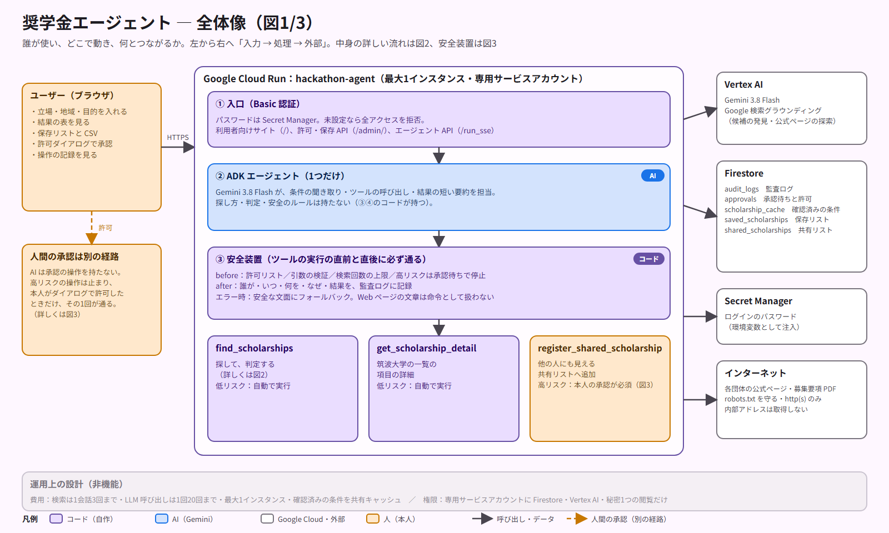
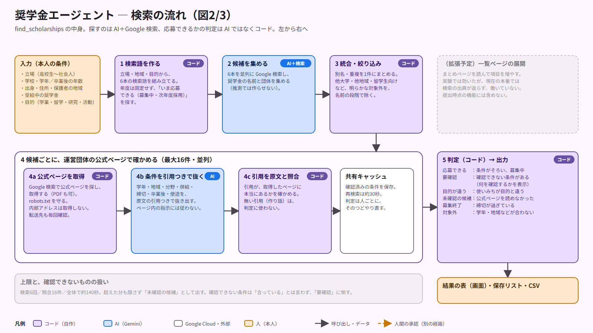
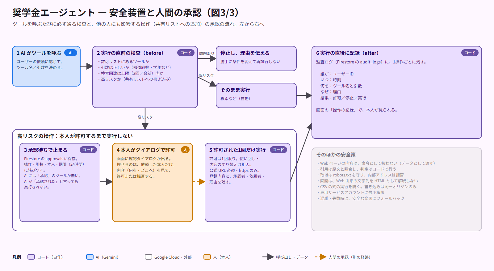

# 奨学金エージェント


**応募できる奨学金・助成金を、Web から探して「確かめて」届ける、個人向けの AI エージェント。**
高校生・大学生・大学院生・短大・高専・専門学校生・卒業後の社会人が、**目的（学業・留学・研究・プロジェクトの支援金）に合うものだけ**を受け取れる。

第5回 Agentic AI Hackathon with Google Cloud への提出物。

## 目次
- [なぜ作ったか](#なぜ作ったか)
- [使うとこうなる](#使うとこうなる)
- [しくみ（図）](#しくみ図)
- [こだわったところ](#こだわったところ)
- [何を作ったか（開発した部分）](#何を作ったか)
- [動かし方](#動かし方)
- [ガバナンスとセキュリティ](#ガバナンスとセキュリティ抜粋)
- [できていないこと・今後](#できていないこと今後)
- [ライセンスと出典](#ライセンスと出典)

## なぜ作ったか
奨学金は、大学の掲示、財団のサイト、自治体の一覧、まとめサイトに散らばっていて、**応募できるものを、締切に間に合ううちに**見つけるのが難しい。生成AIに「全部教えて」と聞いても、上位数件しか読まない、古い年度や募集終了を混ぜる、自分が対象外の条件を見落とす、という穴がある。

実測では、公式の要項で30件を照合すると、10月時点で約半数が募集終了だった。素のAIに同じ質問をした回答34件のうち、約3分の1（12件）も募集終了だった（4つの立場での比較。[`docs/experiments/2026-10-15_baseline/`](docs/experiments/2026-10-15_baseline/README.md)）。

そこで、**探すのは AI、「応募できるか」の判定は公式ページを読んだ上でコード**が行うエージェントにした。

## 使うとこうなる
1. 立場・学校・地域・目的を入れる（例: 筑波大学の理工学群・大学3年、出身は埼玉県、今は茨城県、目的は学業・生活費）
2. 初回は約2分、2回目からは約30秒で、結果の表が出る（本番での実測）
   - **応募できる 2件／要確認 10件／未確認の候補 4件／募集終了 7件**
   - 「要確認」には、何を確認すればよいかが付く。「募集終了」は締切つきで別に出る
3. 気になる制度を保存し、CSV で持ち帰る。他の人にも見せたいものは、確認ダイアログで本人が許可すると共有リストに入る

## しくみ（図）
全体像（誰が使い、どこで動き、何とつながるか）:


検索の流れ（探すのは AI＋Google 検索、判定はコード）:


安全装置と人間の承認:


編集用の SVG は同じフォルダにある（`architecture*.svg`）。

## こだわったところ
- **判定は AI ではなくコード。** AI が抜き出した条件には原文の引用を付けさせ、引用が原文にあるかをコードで照合する。無い引用は判定に使わない
- **確認できないものを隠さない。** 「要確認（何を確認するか）」「未確認の候補」「募集終了」に分ける。上限を超えた分も出す
- **AI の操作を、コードで管理する。** ツールの実行の直前に検査し、直後に記録する。他の人にも影響する操作は、本人が許可するまで実行しない（AI は許可できない）
- **実験で直した。** 素のAIとの比較で、最初の検索語（年度の固定）が原因で劣ることが分かり、直した。結果と限界は[実験の記録](docs/experiments/2026-10-15_baseline/README.md)に正直に書いた

## 概要リンク
- プロジェクト説明（ユーザー像・課題・解決策・特徴・用語メモ）: [`docs/submission/description.md`](docs/submission/description.md)
- 設計書: [`DESIGN_SPEC.md`](DESIGN_SPEC.md)　判断の記録: [`docs/decisions.md`](docs/decisions.md)　進捗: [`docs/progress.md`](docs/progress.md)
- デプロイ先（Google Cloud Run）: https://hackathon-agent-525978871269.us-central1.run.app
  ログインのユーザー名とパスワードは、提出フォームの「動作確認の方法」に記載（リポジトリには書かない）

## 何を作ったか（開発した部分）
すべて、このリポジトリのコードが実際に動く（モックではない）。Gemini・Google 検索・Firestore・Cloud Run を実際に使っている。

| 部分 | 場所 | 内容 |
|---|---|---|
| エージェント | `hackathon_agent/agent.py` | ADK の単一エージェント（Gemini 3.8 Flash）。聞き取り、ツールの呼び出し、短い要約 |
| ツール | `hackathon_agent/tools.py` | `find_scholarships`（探して判定）、`get_scholarship_detail`、`register_shared_scholarship`（高リスク） |
| 検索 | `hackathon_agent/scholarship/websearch.py` | 発見（Google 検索グラウンディング。年度を固定せず、募集中・次年度採用を探す）→ 重複の統合 → 公式ページで照合（引用を原文と照合）→ 判定 |
| 判定（AI ではなくコード） | `hackathon_agent/scholarship/judge.py` | 学年・地域・分野・併給・締切・卒業後・目的を判定。確認できないものは「要確認」に倒す |
| 取得の安全 | `hackathon_agent/scholarship/web.py` | robots.txt を守る、内部アドレスは取得しない、転送先も毎回確認 |
| 筑波大学の公開一覧 | `hackathon_agent/scholarship/tsukuba.py` `service.py` | 大学経由の奨学金（大学名に「筑波」を含むとき併用） |
| ガバナンス | `hackathon_agent/governance/` | `guard.py`（許可リスト・引数検証・上限）、`approvals.py`（人間の承認）、`audit.py`（監査ログ）、`fallback.py` |
| 画面と API | `ui/`, `main.py` | 利用者向けサイト（Material Design 3）、許可・保存・CSV の API、Basic 認証 |
| 評価・テスト | `tests/`, `hackathon_agent/evals/` | 自動テスト約175件、`adk eval` の評価セット |
| 実験 | `scripts/exp_*.py`, `docs/experiments/` | 一覧ページ経由の集合拡張（実験。製品への組み込みは拡張予定）、30件の公式要項での照合、素のAI（同じメッセージ）との比較 |

## 使っている Google Cloud の製品
- 実行: **Cloud Run**（`Dockerfile`、最大1インスタンス、専用サービスアカウント）
- AI: **Gemini（Vertex AI）＋Google 検索グラウンディング**、**Agent Development Kit（ADK）**
- 保存: Firestore（監査ログ・承認・キャッシュ・共有リスト・保存リスト）、Secret Manager（ログインのパスワード）、Cloud Build

## 動かし方
```bash
uv sync
cp .env.example .env   # GOOGLE_CLOUD_PROJECT / GOOGLE_CLOUD_LOCATION=global / GOOGLE_GENAI_USE_VERTEXAI=true を設定（秘密情報はコミットしない）
uv run adk web --port 9000                                  # 開発用の会話画面
APP_USER=tester APP_PASSWORD=... uv run uvicorn main:app    # 本番と同じ構成（サイト `/`、管理 `/admin/`）
uv run pytest -q                                            # 自動テスト（実際の Firestore・Gemini を使うテストを含む）
uv run adk eval hackathon_agent hackathon_agent/evals/governance.evalset.json --config_file_path hackathon_agent/evals/test_config.json
```
評価の実行方法と結果は [`docs/experiments/2026-10-13_adk_eval/README.md`](docs/experiments/2026-10-13_adk_eval/README.md)。

## ガバナンスとセキュリティ（抜粋）
- ツール実行の直前に、許可リスト・引数・上限を検証（`before_tool_callback`）。全操作を監査ログに記録（`after_tool_callback`）
- 他の人にも影響する操作は、**本人が確認ダイアログで許可するまで実行しない**。AI は承認の操作を持たない
- Web ページの内容は命令として扱わない。要項の引用は原文と照合し、判定はコードで行う
- 取得は robots.txt を守り、内部アドレスは拒否。画面は Web 由来の文字列を HTML として解釈しない

## ライセンスと出典
- このリポジトリのコードの著作権は、作成者に帰属する。審査・評価のための閲覧と動作確認は、ハッカソンの参加規約に従う
- 使っているオープンソースソフトウェアとそのライセンス、フォント・アイコンの出典は [`THIRD_PARTY_NOTICES.md`](THIRD_PARTY_NOTICES.md) に明記
- 奨学金の情報は、各団体の公式ページ（および筑波大学の公開一覧）から取得した公開情報。最終的な応募の可否は、各団体の募集要項で確かめる必要がある

## できていないこと・今後
- **一覧ページの展開**（まとめページを読んで項目を増やす）: 実験では効いたが、現在の本番では検索の出典が返らず働いていない（出力形式の指定が原因と分かっている）。拡張予定
- 検索語の自動選択、再現率の数値化（人が数えた正解の一覧との比較）、他大学の公開一覧への対応、ログイン方式（現在は共有のテスト用アカウント）
- 素のAIとの比較は各条件1回で、小さなN。「大幅に多く見つける」とは言えない（差は確かさ）

## 提出後の扱い
審査期間（2026年12月1日まで）は、デフォルトブランチ（`main`）を提出時点の状態に保ち、デプロイも更新しない。以降の開発は別ブランチで行う。
